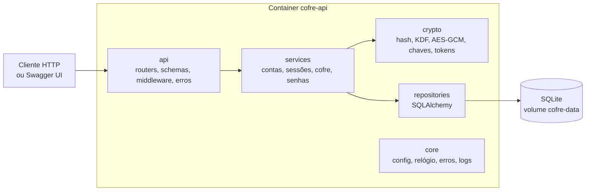

# 10 — Especificação técnica final (As-Built)

> **Status:** Aprovado · **Versão:** 1.0.0 · **Data:** 2026-10-20 · **Release:** `v1.1.0`
> Descreve o Cofre **como foi entregue**. Os documentos 01 a 09 e as specs em `specs/` registram o que foi planejado e decidido; este documento reúne o resultado verificado contra o código, a OpenAPI gerada pela aplicação e a suíte de testes. Em caso de divergência entre este documento e o código, o código manda e este documento deve ser corrigido.

## 1. Resumo

O **Cofre** é uma API REST multiusuário de gerenciamento de senhas. Cada usuário tem um cofre de credenciais cifrado com uma chave própria, protegida pela senha mestra (criptografia em envelope). Não há interface gráfica: a interação é por HTTP, com a Swagger UI em `/docs`.

| Item | Valor |
|------|-------|
| Linguagem e framework | Python 3.13, FastAPI, Uvicorn |
| Persistência | SQLite, via SQLAlchemy 2 |
| Criptografia | `argon2-cffi` (Argon2id) e `cryptography` (AES-256-GCM, HKDF-SHA256) |
| Configuração | `pydantic-settings`, variáveis `COFRE_*` |
| Ambiente | Docker Compose (serviços `api` e `tests`) e `uv` |
| Testes | `pytest`, 420 na suíte padrão, cobertura de linhas e ramificações de 98,83% |
| CI | GitHub Actions: `lint`, `test` e `docker`, obrigatórios em `main` e `develop` |
| Licença | MIT |

## 2. Escopo entregue

| Unidade | Requisitos | Prioridade | Situação | Spec |
|---------|------------|------------|----------|------|
| 001 Fundação da API | RF-01; RNF-08 a RNF-11, RNF-13 a RNF-15 | Must, Should e Could | Implementada | [spec 001](../specs/001-fundacao-da-api/spec.md) |
| 002 Contas e sessões | RF-02 a RF-04 (*Must*), RF-05 e RF-06 (*Should*), RF-07 (*Could*) | Must a Could | Implementada | [spec 002](../specs/002-contas-e-sessoes/spec.md) |
| 003 Cofre de credenciais | RF-08, RF-09, RF-11 a RF-13 (*Must*), RF-10 (*Should*) | Must e Should | Implementada | [spec 003](../specs/003-cofre-de-credenciais/spec.md) |
| 004 Gerador e avaliador de senhas | RF-14 (*Must*), RF-15 (*Should*) | Must e Should | Implementada | [spec 004](../specs/004-gerador-de-senhas/spec.md) |
| 005 Saúde do cofre | RF-16 | Could | **Fora do escopo** (R-028) | — |

Todos os requisitos *Must* e *Should* e os *Could* RF-07, RNF-13 e RNF-14/RNF-15 estão implementados e têm ao menos um teste. O único requisito não atendido é o RF-16 (relatório de saúde do cofre, que listaria senhas fracas e reutilizadas), retirado do escopo por decisão do mantenedor e registrada em [R-028](registro-de-refinamentos.md). Por isso a rota `/api/v1/vault/health-report`, prevista na arquitetura original, **não existe**.

## 3. Arquitetura como entregue

Monólito modular em camadas, num único processo e com um único banco ([docs/03](03-arquitetura.md)). A regra de dependência é `api → services → (crypto, repositories) → core`, e nenhuma camada importa outra acima dela.



### 3.1 Módulos (`src/cofre/`)

| Camada | Módulos | Papel |
|--------|---------|-------|
| `main` | `main.py` | Fábrica `create_app(settings=None, clock=None)`, iniciada com `--factory`. |
| `api` | `routers/` (`health`, `accounts`, `sessions`, `credentials`, `passwords`), `schemas/`, `deps.py`, `errors.py`, `middleware.py` | HTTP, validação de entrada e saída, autenticação por dependência e tradução de erros. |
| `services` | `accounts`, `sessions`, `throttle`, `vault`, `passwords`, `validation`, `health` | Regras de negócio; não importam FastAPI. |
| `crypto` | `hashing`, `kdf`, `cipher`, `keys`, `tokens` | Primitivas criptográficas; só usam `cryptography` e `argon2-cffi`. |
| `repositories` | `database`, `models`, `users`, `sessions`, `credentials`, `login_throttles` | Persistência; toda consulta de recurso de usuário filtra por `user_id`. |
| `core` | `config`, `clock`, `errors`, `logging` | Configuração, relógio injetável, erros de domínio e logs JSON. |

O gerador e o avaliador de senhas (`services/passwords.py`) não dependem de login nem de banco. A aleatoriedade do gerador é injetável e usa `secrets` por padrão.

## 4. Contrato da API

Base: `/api/v1`, mais `/health` fora do prefixo. JSON em `snake_case`; datas ISO 8601 em UTC. Toda resposta traz `X-Request-ID` (o do cliente é propagado se tiver até 64 caracteres entre letras, dígitos e hífen; caso contrário, é gerado um UUID v4), e as respostas sob `/api/v1` trazem `Cache-Control: no-store`. A especificação OpenAPI 3 é publicada pela própria aplicação em `/openapi.json` e `/docs`, e os testes de contrato a comparam com [o contrato da unidade 001](../specs/001-fundacao-da-api/contracts/openapi.yaml) e com as tabelas das specs ([ADR-0016](adr/0016-testes-de-contrato-contra-openapi-da-spec.md)).

| Método e rota | Auth | Requisito | Sucesso | Erros possíveis |
|---------------|:----:|-----------|---------|-----------------|
| `GET /health` | — | RF-01 | 200 `{status: "ok"}` | 503 `SERVICE_UNAVAILABLE` |
| `POST /api/v1/accounts` | — | RF-02 | 201 `{id, email, created_at}` | 409 `EMAIL_ALREADY_REGISTERED`, 422 |
| `POST /api/v1/sessions` | — | RF-03 | 201 `{token, expires_at}` | 401 `INVALID_CREDENTIALS`, 429 `TOO_MANY_ATTEMPTS` (com `Retry-After`), 422 |
| `DELETE /api/v1/sessions/current` | Bearer | RF-04 | 204 | 401 `UNAUTHENTICATED` |
| `GET /api/v1/accounts/me` | Bearer | RF-05 | 200 `{id, email, created_at}` | 401 |
| `PUT /api/v1/accounts/me/master-password` | Bearer | RF-06 | 204 | 401, 403 `INVALID_MASTER_PASSWORD`, 422, 429 |
| `POST /api/v1/accounts/me/deletion` | Bearer | RF-07 | 204 | 401, 403 `INVALID_MASTER_PASSWORD`, 429 |
| `POST /api/v1/credentials` | Bearer | RF-08 | 201 credencial, sem a senha | 401, 409 `VAULT_LIMIT_REACHED`, 422 |
| `GET /api/v1/credentials?q=&limit=&offset=` | Bearer | RF-09, RF-10 | 200 `{items, total, limit, offset}` | 401, 422 |
| `GET /api/v1/credentials/{id}` | Bearer | RF-11 | 200 credencial com `password` | 401, 404, 422 |
| `PATCH /api/v1/credentials/{id}` | Bearer | RF-12 | 200 credencial, sem a senha | 401, 404, 422 |
| `DELETE /api/v1/credentials/{id}` | Bearer | RF-13 | 204 | 401, 404, 422 |
| `POST /api/v1/passwords/generate` | — | RF-14 | 200 `{password}` | 422 |
| `POST /api/v1/passwords/strength` | — | RF-15 | 200 `{score, weak, crack_time_seconds, crack_time_display, suggestions}` | 422 |

Detalhes que os contratos fixam:

- A listagem é ordenada por título e **nunca** devolve senhas; `limit` vai de 1 a 100 (padrão 20) e `offset` começa em 0. A busca `q` compara título, usuário e URL. A senha só aparece na consulta individual (RN-08).
- A exclusão de conta usa `POST .../deletion` porque exige a senha mestra no corpo.
- Recurso de outro usuário responde **404**, igual a recurso inexistente (RNF-03).
- O gerador aceita `length` de 8 a 128 (padrão 20) e as opções `lowercase`, `uppercase`, `digits`, `symbols` e `exclude_ambiguous`; com todos os conjuntos desligados responde 422.
- O avaliador aceita de 1 a 1024 caracteres. `score` vai de 0 a 4, e `weak` é verdadeiro quando `score <= 2`.

### 4.1 Formato único de erro e catálogo

```json
{"error": {"code": "INVALID_CREDENTIALS", "message": "E-mail ou senha incorretos.", "details": null}}
```

`details` só existe em 422, com `field` e `issue` por campo, sem o valor recebido. O `code` é estável e em inglês; a `message` é em pt-BR.

| HTTP | `code` | Quando |
|------|--------|--------|
| 401 | `UNAUTHENTICATED` | Token ausente, malformado, expirado ou revogado. Inclui `WWW-Authenticate: Bearer`. |
| 401 | `INVALID_CREDENTIALS` | Login com e-mail ou senha incorretos (mensagem igual para e-mail inexistente). |
| 403 | `INVALID_MASTER_PASSWORD` | Senha mestra errada na troca ou na exclusão de conta. |
| 404 | `NOT_FOUND` | Rota ou recurso inexistente, ou de outro usuário. |
| 405 | `METHOD_NOT_ALLOWED` | Método HTTP não suportado pela rota. |
| 409 | `EMAIL_ALREADY_REGISTERED` | Cadastro com e-mail já existente. |
| 409 | `VAULT_LIMIT_REACHED` | Mais de 1.000 credenciais para o usuário. |
| 422 | `VALIDATION_ERROR` | Corpo, parâmetro ou caminho inválido. |
| 429 | `TOO_MANY_ATTEMPTS` | Bloqueio por força bruta, com `Retry-After`. |
| 500 | `INTERNAL_ERROR` | Erro inesperado, sem detalhes na resposta. |
| 503 | `SERVICE_UNAVAILABLE` | Banco indisponível em `/health`. |

## 5. Modelo de dados

Quatro tabelas SQLite. Datas gravadas em UTC.

| Tabela | Colunas principais | Observação |
|--------|--------------------|------------|
| `users` | `id`, `email` (único, até 254), `password_hash`, `kdf_salt`, `kdf_params`, `wrapped_dek`, `created_at`, `updated_at` | A senha mestra nunca é gravada; só o hash Argon2id e a chave de dados embrulhada. |
| `sessions` | `id`, `user_id`, `token_hash` (único), `session_wrapped_dek`, `created_at`, `expires_at` | O banco guarda só o hash do token, nunca o token. |
| `login_throttles` | `email_hash` (chave), `failed_count`, `locked_until`, `updated_at` | Sem chave estrangeira: e-mails inexistentes também contam, para não revelar quais contas existem. |
| `credentials` | `id`, `user_id`, `ciphertext`, `enc_version`, `created_at`, `updated_at` | Todos os campos da credencial ficam dentro de `ciphertext`; nada em claro ([ADR-0010](adr/0010-cifrar-todos-os-campos-da-credencial.md)). |

## 6. Segurança como entregue

Detalhes e modelo de ameaças em [docs/04](04-seguranca.md); decisões em [ADR-0008](adr/0008-criptografia-em-envelope.md) e [ADR-0009](adr/0009-sessoes-com-token-opaco.md).

| Mecanismo | Como ficou |
|-----------|-----------|
| Senha mestra | Normalizada em Unicode NFKC; 12 a 128 caracteres; hash Argon2id (memória de 19.456 KiB, 2 iterações, paralelismo 1). |
| Chaves | Uma chave de dados (DEK) de 256 bits por usuário, embrulhada por uma chave derivada da senha mestra (Argon2id com sal próprio). Trocar a senha mestra reembrulha a DEK e não recifra o cofre. |
| Credenciais | AES-256-GCM, nonce novo de 12 bytes por operação e dados associados que ligam o texto cifrado ao usuário e à credencial: trocar o `ciphertext` entre linhas ou usuários falha. |
| Sessão | Token opaco de 256 bits (`secrets`), validade de 30 minutos, guardado como SHA-256; a DEK da sessão é embrulhada por uma chave derivada do token (HKDF-SHA256). |
| Força bruta | Cinco falhas bloqueiam o e-mail por 15 minutos. A contagem é atômica (R-026) e vale também para senha mestra errada em troca e exclusão de conta, que revogam as sessões ao atingir o limite. |
| Enumeração de contas | Mensagem de login igual para e-mail inexistente, com verificação Argon2id contra hash fictício para igualar o tempo. |
| Isolamento | Toda consulta filtra por `user_id`; recurso alheio dá 404. |
| Logs | JSON por requisição, com id, método, rota, status e duração. Senhas, tokens, chaves, `ciphertext`, corpo e cabeçalho `Authorization` nunca são registrados, e testes procuram esses valores nos logs. |
| Aleatoriedade | Somente `secrets` e `os.urandom`; não há `import random` em `src/` (verificado por teste). |

## 7. Configuração

A aplicação lê o ambiente (variáveis `COFRE_*`), e não o arquivo `.env.example`, que só documenta. Valores inválidos impedem a inicialização, com mensagem que cita a variável e o motivo, sem o valor.

| Variável | Padrão | Significado |
|----------|--------|-------------|
| `COFRE_ENV` | `production` | `production`, `development` ou `test`. Só `test` aceita parâmetros do Argon2id abaixo do mínimo. |
| `COFRE_DATABASE_URL` | `sqlite:///./data/cofre.db` | URL SQLAlchemy; apenas SQLite. No Docker: `sqlite:////data/cofre.db`. |
| `COFRE_SESSION_TTL_MINUTES` | `30` | Validade da sessão. |
| `COFRE_LOGIN_MAX_ATTEMPTS` | `5` | Falhas antes do bloqueio. |
| `COFRE_LOGIN_LOCK_MINUTES` | `15` | Duração do bloqueio. |
| `COFRE_MAX_CREDENTIALS_PER_USER` | `1000` | Limite de credenciais por usuário. |
| `COFRE_ARGON2_MEMORY_KIB` | `19456` | Memória do Argon2id (mínimo 19456 fora de `test`). |
| `COFRE_ARGON2_TIME_COST` | `2` | Iterações do Argon2id (mínimo 2 fora de `test`). |
| `COFRE_ARGON2_PARALLELISM` | `1` | Paralelismo do Argon2id. |
| `COFRE_LOG_LEVEL` | `INFO` | `DEBUG`, `INFO`, `WARNING`, `ERROR` ou `CRITICAL`. |

## 8. Ambiente, execução e qualidade

```bash
docker compose up --build          # API em http://localhost:8000 e Swagger em /docs
docker compose run --rm tests      # suíte completa no container; relatórios em ./reports
uv sync && uv run pytest           # sem Docker
uv run ruff check . && uv run ruff format --check .
```

- A imagem tem três estágios: `runtime` (sem dependências de desenvolvimento e com usuário sem privilégios), `build` e `test`. O banco fica no volume `cofre-data`.
- O CI executa três jobs, todos obrigatórios para o merge: `lint` (lockfile, `ruff check` e `ruff format --check`), `test` (suíte com o gate de cobertura de 85%) e `docker` (testes de fumaça e suíte no container).
- Dependências travadas em `uv.lock`.

## 9. Resultado dos testes

Execução de `docker compose run --rm tests` na `develop` em 2026-10-20 ([logs_testes_final.txt](../logs_testes_final.txt)):

| Total | Passaram | Falharam | Pulados | Cobertura (linhas e ramificações) |
|------:|---------:|---------:|--------:|----------------------------------:|
| 420 | 420 | 0 | 0 | 98,83% |

Por nível: 209 unitários, 17 de integração, 169 de API (com validação do contrato), 25 de segurança. Fora da seleção padrão, em execução separada: 1 teste de desempenho (RNF-12, p95 abaixo de 200 ms com 1.000 credenciais) e 5 testes de fumaça com Docker Compose. A suíte roda em ordem aleatória (`pytest-randomly`). Os relatórios por incremento estão em [docs/relatorios/](relatorios/README.md) e o mapa requisito → testes é gerado em `reports/rastreabilidade.md` a cada execução.

## 10. Desvios em relação ao planejado

| Desvio | Motivo | Registro |
|--------|--------|----------|
| RF-16 e unidade 005 não implementados | Requisito *Could*; decisão do mantenedor | [R-028](registro-de-refinamentos.md) |
| Rota `/api/v1/vault/health-report` e `VaultHealthService` removidos da arquitetura | Consequência do item anterior | docs/03 v1.2.1 |
| Unidades 002 a 004 com fluxo enxuto (sem `/speckit-*` e com uma issue por unidade) | Prazo e economia de custo | [sessão da fase A](sessoes/2026-09-30-fase-a-unidades-002-003.md) |
| `/security-review` não executado nas unidades 002 e 003, apesar de o `CLAUDE.md` exigi-lo | Economia de custo, decisão do mantenedor | [relatório técnico-ético](relatorios/relatorio-etico-tecnico.md) |
| Avaliador de senhas é uma heurística própria, sem biblioteca de estimativa | Evitar dependência nova para um requisito *Should* | spec 004, FR-007 a FR-010 |
| Revisão por pares substituída por autorrevisão e revisão assistida por IA | Projeto individual | [ADR-0012](adr/0012-revisao-de-codigo-em-projeto-individual.md) |
| 28 refinamentos da especificação em vez de uma especificação estática | Testes e revisões revelaram lacunas | [registro](registro-de-refinamentos.md) |

## 11. Limitações e riscos aceitos

- **Escrita concorrente limitada.** O SQLite serializa as escritas; as de cada usuário são serializadas de propósito para evitar corridas (E-07 em [ERROS.md](ERROS.md)). Não há múltiplas instâncias.
- **Cofre de até 1.000 credenciais.** Como todos os campos são cifrados, busca e ordenação ocorrem em memória, com custo O(n) por listagem.
- **Senha mestra esquecida torna os dados irrecuperáveis.** Não há recuperação de conta (RN-03).
- **Token com SHA-256 sem sal.** Aceitável porque o token tem 256 bits de entropia; documentado em docs/04.
- **Tabela de tentativas sem limite de ritmo.** Linhas ociosas são apagadas após 24 horas, mas o ritmo de inserção por e-mails inexistentes não é limitado (exigiria limite por origem).
- **TLS fora da aplicação.** Deve ser terminado por um proxy reverso na implantação.
- **Revisão independente ausente.** Nenhum erro foi detectado por revisão humana independente; a limitação é discutida no relatório técnico-ético.

## 12. Rastreabilidade

| Pergunta | Onde está |
|----------|-----------|
| O que foi pedido? | [docs/02 — Requisitos](02-requisitos.md) e as specs em [specs/](../specs/) |
| Por que foi decidido assim? | [ADRs](adr/README.md) e o [consolidado](adr/consolidado.md) |
| O que mudou na especificação e por quê? | [Registro de refinamentos](registro-de-refinamentos.md) (R-001 a R-028) |
| Que erros apareceram? | [ERROS.md](ERROS.md) |
| Como foi testado? | [Relatórios de execução](relatorios/README.md) e [logs_testes_final.txt](../logs_testes_final.txt) |
| Como o agente de IA foi usado? | [Relatório técnico-ético](relatorios/relatorio-etico-tecnico.md) e [relato de experiência](relatorios/relato-de-experiencia.md) |

## 13. Histórico de revisões

| Versão | Data | Mudança | Origem |
|--------|------|---------|--------|
| 1.0.0 | 2026-10-20 | Versão inicial, escrita sobre o código e a OpenAPI da release `v1.1.0`. | Entrega final |
